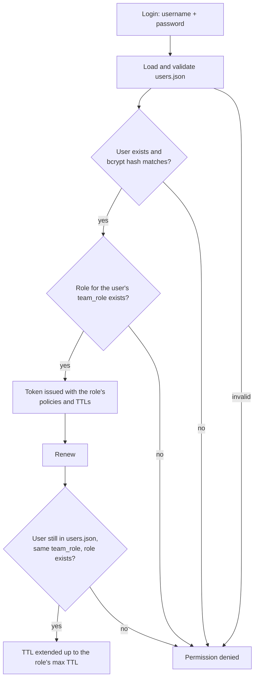

# Vault auth plugin that uses a JSON file as its source of truth


## What is it
A Vault authentication plugin, built with the official HashiCorp SDK. It works like the `userpass` auth method, but the users are stored in a JSON file. Passwords are stored as bcrypt hashes, and every user is mapped to a role by its `team_role`.

## How it works
An admin sets the path of the users file (`config`) and one role per `team_role` (`role/<name>`). The users file is read again on every login and renew. Any failure ends in `permission denied`, the plugin never falls back to allowing access.



- A login is denied if the configuration is missing, the users file is missing or invalid, the user or password is wrong, or the user's `team_role` has no role.
- A renew is denied if the user was removed from the file, moved to another `team_role`, or the role was deleted. Tokens issued by a version older than the one that stores `user_id` cannot be renewed, the user has to login again.

## Prerequisites
- Golang (for building)
- A Vault server (CE or Enterprise) and the `vault` CLI
- For `./docker-test.sh` also: Docker (or Podman), `jq` and `shasum`

## Quick start
Run `./docker-test.sh`. It builds the plugin, starts a Vault server in a container using the official image, registers and enables the plugin, creates three roles, and logs in as three users. The script generates `bin/users.json` from `users.example.json`, using the hash of `hashed_password_here`.

## Install
1. Clone the repository and change into its directory: `git clone https://github.com/martinhristov90/authjson && cd authjson`.
2. Build the plugin. The version is taken from the nearest git tag (for example the tag `v0.3.0` gives `0.3.0`, builds without a tag get a `0.0.0-dev-<commit>` version). `make version` prints it, and `make dev` builds for Linux (`GOOS` and `OUTPUT` can be overridden). For other architectures, set `GOARCH` of the Vault server:
    ```
    VERSION=$(make -s version)
    GOARCH=amd64 make dev
    ```
3. Put the binary in the `plugin_directory` of the Vault server, and register it with the same version:
    ```
    vault write sys/plugins/catalog/auth/vault-auth-jsonauth \
    sha_256=$(shasum -a 256 vault-auth-jsonauth | cut -d' ' -f1) \
    command="vault-auth-jsonauth" \
    version="v$VERSION"
    ```
4. Enable the plugin at the desired path (usually `jsonauth`):
    ```
    vault auth enable \
    -path="jsonauth" \
    -plugin-name="vault-auth-jsonauth" \
    -plugin-version="v$VERSION" \
    plugin
    ```
5. Create the users file, see [Users file](#users-file).
6. Configure the path of the users file. The path is read by the Vault server, so the file has to exist on the machine where Vault runs and be readable by the user Vault runs as. The file is validated when the configuration is written, an invalid file is rejected. Without this step every login is denied:
    ```
    vault write auth/jsonauth/config users_file_path="/path/to/users.json"
    ```
7. Create the roles that are allowed to login. Role names must match the `team_role` of the users. A user whose `team_role` has no role cannot login:
    ```
    vault write auth/jsonauth/role/core token_policies=core_policy token_max_ttl=12h token_ttl=1h
    vault write auth/jsonauth/role/backline token_policies=backline_policy token_max_ttl=3h token_ttl=1h
    vault write auth/jsonauth/role/manager token_policies=manager_policy token_max_ttl=36h token_ttl=1h
    ```
   Roles accept the standard token parameters: `token_policies`, `token_ttl`, `token_max_ttl`, `token_period`, `token_num_uses`, `token_type` and `token_bound_cidrs`. The older `policies`, `ttl`, `max_ttl`, `period`, `num_uses` and `bound_cidrs` are deprecated aliases.
8. Login:
    ```
    vault write auth/jsonauth/login password=hashed_password_here username=user-martin
    ```
   The output is similar to:
    ```
    Key                     Value
    ---                     -----
    token                   h<SNIP>s.CAESICRJapqI<SNIP>nTXZwaHN0aTk1UHY
    token_accessor          X2LSpgMjVgla8TxyH4I6sPkh
    token_duration          1h
    token_renewable         true
    token_policies          ["backline_policy" "default"]
    identity_policies       []
    policies                ["backline_policy" "default"]
    token_meta_team_role    backline
    ```

## Users file
Create the file by copying the template: `cp users.example.json users.json`. `users.json` in the root directory is git-ignored, so real hashes are not committed by accident.

The `password` field holds the **bcrypt hash** of the user's password, never the password itself. Create the hash with the helper of this repository. The password is read from the standard input, so it does not end up in the shell history:
```
read -rs PW && printf '%s' "$PW" | go run ./cmd/hashpw
```
The default cost is 12, it can be changed via `-cost` (4 to 31). Passwords are limited to 72 bytes, which is a limit of bcrypt.

Example (`$2a$12$<SNIP>` stands for the full hash. `users.example.json` holds the placeholder `REPLACE_WITH_BCRYPT_HASH` instead, and `./docker-test.sh` fills it with the hash of `hashed_password_here`, the password used in the examples of this README):
```json
[
  {
    "user_id": "user-martin",
    "email": "marti@hashitest.com",
    "password": "$2a$12$<SNIP>",
    "given_name": "Martin",
    "family_name": "Hristov",
    "nickname": "Marti",
    "team_role": "backline"
  }
]
```

Every user needs a unique `user_id`, a `password` that is a bcrypt hash and a `team_role`. The file is validated when the configuration is written, and again on every login and renew. If it is invalid (duplicate IDs, empty fields, plaintext passwords) writing the configuration fails with a message listing all the problems, and logins and renewals are denied until the file is fixed.

## Upgrading
Passwords in the users file used to be plaintext. They must now be bcrypt hashes, a file with plaintext passwords is rejected. Replace every password with its hash (see [Users file](#users-file)) before upgrading.

## Security notes
- Make the users file readable only by the user Vault runs as (for example `chmod 600`). It holds password hashes.
- The file is re-read on every login and renew, so changes apply immediately. Removing a user also blocks the renewal of that user's tokens, but already issued tokens stay valid until they expire or are revoked.
- A higher bcrypt cost makes brute force harder, and every login slower. The default cost of 12 takes a few hundred milliseconds per login.
- There is no rate limiting or lockout of failed logins yet.
- `hashed_password_here` is a demo password, never use it outside of tests.

## Development
- Run the tests: `go test -race ./...`. The tests generate `integration_test_data/users.json` from `users.example.json` and remove it afterwards.
- `make dev` builds the plugin, `make setup-intergration-test` runs `./docker-test.sh`.
- `cmd/hashpw` creates bcrypt hashes for the users file.

## TODO
- [x] Hash the password of the users + salt (bcrypt)
- [x] Implement `renew` operation based on user's role
- [ ] Rate limiting or lockout of failed logins
- [ ] Reject bcrypt hashes with a too low cost
- [ ] Makefile targets for formatting, vetting and testing, and a CI pipeline
- [ ] Support `vault login -method=jsonauth` (needs a login handler in the Vault CLI)

## License
[MIT](LICENSE)
